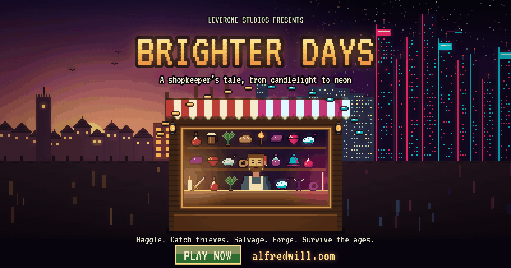

# Brighter Days

A pixel-art shopkeeper game by **LeverOne Studios** that runs in the browser. Haggle with customers, catch thieves, salvage scrap, forge masterworks, and run your shop from the Medieval Age to the Neon Age.

**Play:** https://theanarchyram.github.io/BrighterDays/



## Files

| Path | What it is |
|---|---|
| `index.html` | The whole game in one file |
| `dict/` | Data for the in-game American Dictionary, loaded only when the book is opened |
| `images/` | Cover art, ads (PNG and animated GIF) and the site icon |
| `embed-snippets.html` | Code for adding the game or its banner to another website |

## Run locally

```
python3 -m http.server 8000
```
Then open http://localhost:8000. The dictionary needs a web server to load.

## Coming later

These need a backend and are on the deployment task list: online accounts (Google, Microsoft, email, username and password), the Exchange leaderboard, sending bug reports, and cloud saves. Saves currently stay on each device, in three slots.

## Credits

Created by **LeverOne Studios**.

## License

The game is released under the MIT License (see `LICENSE`). Dictionary definitions come from Princeton WordNet 3.0 and are covered by their own license in `dict/WORDNET-LICENSE.txt`.
